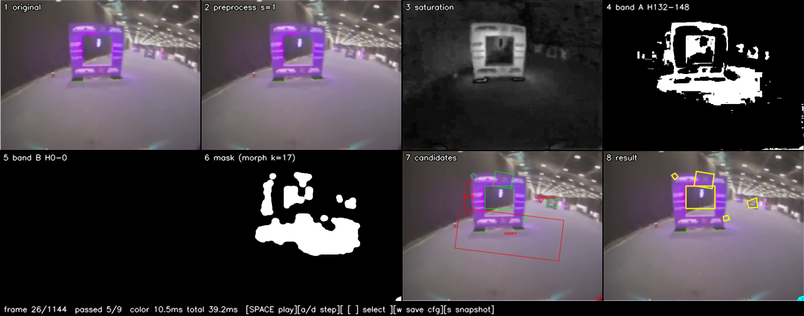
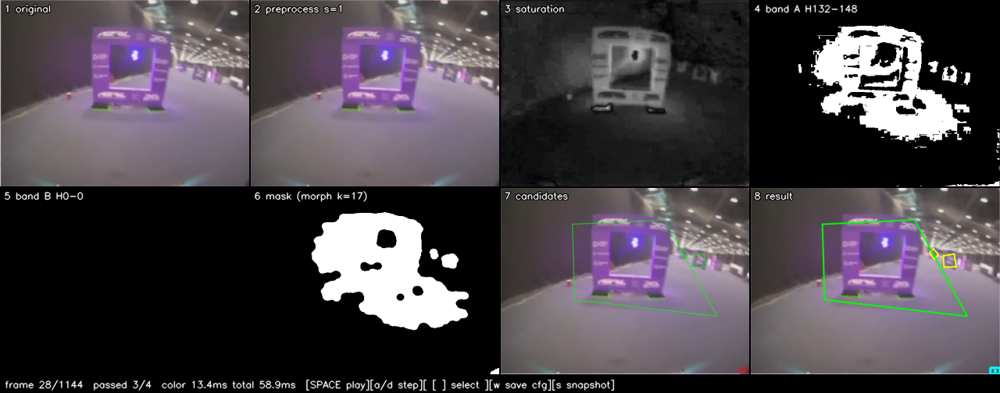

# Part 1: Gate Detection

Find racing gates in FPV video and outline them, using classical computer vision only using no neural network. The core is a color-first HSV pipeline; the visual tuner lets you step through footage frame by frame, watch every stage of the pipeline, and dial in the parameters by eye until the gates are outlined reliably.

This is the perception stage. Pose estimation, control, and simulator integration are later parts.

## Files and how they relate

```
gate_detection_core.py        The detector (no UI).
        |
        +-- tuner.py          Main tool
        |
gate_config.json              The saved parameters written by the tuner
```

- **`gate_detection_core.py`**  The actual detector. One class, `GateDetector`, that takes a BGR frame and returns gate detections (corners, bounding box, confidence). No windows, no capture, no threads. `process_frame()` returns the gates; `process_frame_debug()` also returns every intermediate image (masks, HSV channels, per-candidate stats) so the tuner can show them.
- **`tuner.py`** - Loads a video, runs the debug pipeline on the current frame, and shows all eight stages plus a zoom on the selected candidate. Trackbars adjust the parameters live; `w` saves them to `gate_config.json`. This is where the work happens.
- **`gate_config.json`** - the tuned parameters. The tuner writes it; both the tuner and the overlay load it on startup. This file *is* the result of Part 1.
- **`WINNING_TECHNIQUES.md`** - why the pipeline is built this way, mapped to the paper it draws from.
- **`BUILD_SPEC_TUNER.md`** - the implementation spec for the core and tuner.

## How detection works

Classical CV, color-first. The gates are a saturated color (purple in my
footage) against a somewhat grey arena, so a saturation-gated color threshold isolates them almost completely. The tuner's eight panels correspond one-to-one
to these steps:

1. **Original** - the frame, resized to a fixed processing width for speed.
2. **Preprocess** - an optional bilateral filter (edge-preserving blur) to calm motion blur and sensor noise without smearing the gate edges.
3. **Saturation** - the HSV saturation channel. This is what separates the vivid gate from the flat grey background; it is the channel the color threshold leans on.
4. **Band A mask** - pixels whose hue falls in the gate's color range and whose saturation/value clear the floors. This is the main gate mask.
5. **Band B mask** - an optional second color band, off by default. Use it only if gates come in a second color.
6. **Cleaned mask** - morphological close then open: close fills gaps in the gate outline, open removes stray specks.
7. **Candidates** - contours found in the cleaned mask. Each contour is reduced to a quadrilateral with `approxPolyDP` (its true four corners, so an angled gate gives its real trapezoid rather than a bounding box), and the contour hierarchy recovers the inner opening's corners too. Green = passed the shape filters, red = rejected (with the reason).
8. **Result** - the gates that passed, colored by confidence (green high, yellow medium, red low). The selected candidate is highlighted in cyan.

Corners, not just boxes: the detector orders the four outer corners `[top-left, top-right, bottom-right, bottom-left]` and finds the inner opening's corners the same way. That ordered corner set is what a later part needs to recover the gate's 3D pose.

## Setup

```bash
python -m venv .venv
.venv\Scripts\activate        # Windows
pip install -r requirements.txt
```

Dependencies are small: OpenCV, NumPy, Pillow, and `mss` (the last only for the
optional overlay).

Verify:

```bash
python -c "import cv2, numpy, mss; print('ok')"
```

## Running the tuner

```bash
python tuner.py path\to\footage.mp4
```

With no argument it uses the first `.mp4` in the current directory. Four windows
open:

- **pipeline** - the 8-panel mosaic above, with a status bar along the bottom.
- **gate zoom** - a close-up of the selected candidate (proc / mask / saturation crops) with its corners numbered and its measured stats vs. the thresholds, so you can see exactly why a candidate passed or was rejected.
- **tune: color** and **tune: shape** - two trackbar panels (split so they fit on screen and stay resizable).

### What each control does

**tune: color** - isolate the gate's color.

| Control | What it does |
|---|---|
| `proc_width` | Processing resolution. Higher = more detail but slower. |
| `bilateral_sigma` | Strength of the edge-preserving blur. Higher = smoother, but can erase thin gate edges. |
| `band_a_h_lo` / `band_a_h_hi` | The hue range that counts as gate color. This is the main color knob - narrow it around the gate's hue. |
| `band_b_h_lo` / `band_b_h_hi` | A second hue range. Only matters if band B is toggled on (`2`). |
| `sat_min` | Saturation floor. Raise it to reject the grey background and white lights; lower it if a faded gate is being dropped. |
| `val_min` / `val_max` | Brightness window. `val_max` below 255 rejects blown-out highlights (ceiling lights); `val_min` rejects near-black. |

**tune: shape** - decide which colored blobs are actually gates.

| Control | What it does |
|---|---|
| `frame` | Seek through the video. |
| `morph_kernel` | Size of the close/open kernel. Bigger = fills larger gaps in the outline and removes bigger specks, but can merge nearby blobs. |
| `min_area x10000` | Smallest blob allowed, as a fraction of the frame. Raise it to drop distant/tiny false positives. |
| `min_solidity x100` | How filled-in the shape must be (area ÷ convex hull). Raise it to reject ragged, spindly blobs. |
| `min_aspect` / `max_aspect` | Allowed width:height ratio. Gates are roughly square, so a band around 1.0 rejects long thin shapes. |
| `approx_eps x1000` | Corner-simplification tolerance. Higher = the contour is simplified harder toward four clean corners; too high loses real shape, too low keeps noisy extra vertices. |
| `gate_conf x100` | Confidence threshold. A candidate must score above this to be reported as a gate. |

Confidence is `0.5 × solidity + 0.5 × size` - a well-filled, reasonably large
blob scores high.

### Keyboard controls

| Key | Action |
|---|---|
| `Space` | Play / pause |
| `a` / `d` or `←` / `→` | Step one frame back / forward |
| `A` / `D` | Jump 30 frames back / forward |
| `[` / `]` | Select previous / next candidate (drives the zoom window) |
| `p` | Toggle the preprocess blur |
| `1` / `2` | Toggle color band A / B |
| `w` | Save current parameters to `gate_config.json` |
| `s` | Save a snapshot (mosaic PNG + params JSON) to `snapshots/` |
| `q` or `Esc` | Quit |

### A tuning pass, start to finish

1. Seek (`frame` slider or `a`/`d`) to a frame with a clear gate.
2. Watch the **saturation** panel - the gate should stand out bright against a
   dark background. If it does, color will work.
3. Set `band_a_h_lo`/`band_a_h_hi` around the gate's hue until the **band A**
   panel lights up on the gate and little else.
4. Raise `sat_min` until the grey background and white lights go black in the
   mask, backing off if the gate itself starts breaking up.
5. Use `val_min`/`val_max` to knock out anything too dark or too bright.
6. Bump `morph_kernel` until the **cleaned mask** shows a solid, connected gate
   outline.
7. Tighten the shape filters (`min_area`, `min_solidity`, `min_aspect`/
   `max_aspect`) until the **candidates** panel shows green on gates and red on
   everything else.
8. Set `gate_conf` just below the confidence of real gates and above the junk.
9. Step through more frames to confirm it holds, then press `w` to save.

## Examples

Both captured with the tuner at the settings now in `gate_config.json`
(purple band, hue 132–148; `sat_min` 37; `morph_kernel` 17), two consecutive
frames of the test footage. Panels read left-to-right, top-to-bottom in the
order described above; the bottom-right panel is the final result.





As a first tuned pass this is already outlining the gate well.

## The optional overlay

```bash
python gate_overlay.py
```

Open a gate video in any media player first. This starts screen capture, a
transparent always-on-top overlay, and a small control panel, and draws the
tuned detector's output over whatever it captures. It loads the same
`gate_config.json`, so tune in the tuner first, then run this to watch it live.

## Not tracked in git

Test footage (`*.mp4`) and any model weights (`*.pt`) are gitignored - supply
your own video. The footage in the examples is [this clip](https://www.youtube.com/watch?v=yz2in2eFATE),
cropped to the FPV view. The two example mosaics under `snapshots/` are the only
files kept from that folder; everything else the tuner writes there is ignored.
